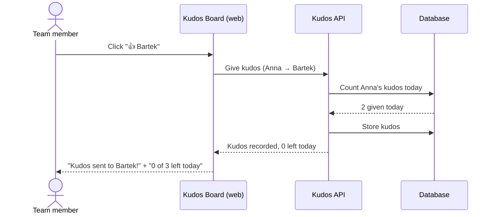
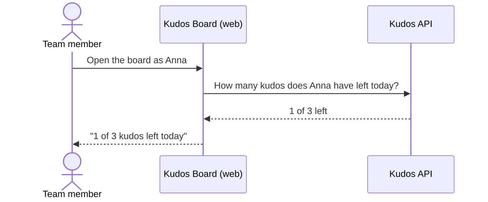

# Daily Kudos Limit

Type: feature
Started: 2026-10-22

## Overview

Each team member can give at most 3 kudos per day. The limit keeps kudos
meaningful — they reward real work instead of reflex clicking. The board shows
how many kudos you have left today and explains it when you run out.

## Primary Actors

- **Team member** — gives kudos and sees how many they have left today.

## Business Rules

1. A team member can give at most **3 kudos per day** — to anyone, including
   the same person several times.
2. Only kudos that were actually recorded count toward the limit. Rejected
   attempts (kudos to yourself, unknown teammate, over the limit) do not use
   up the allowance.
3. A "day" is a calendar day in the team's time zone; the allowance resets at
   midnight. The team's time zone is a single setting (UTC or a region such as
   Europe/Warsaw) and defaults to UTC. An unknown time zone stops the board from
   starting rather than failing later.
4. The limit is per giver. Receiving kudos never affects how many you can give.
5. The limit holds even when several kudos are sent at the same moment.
6. Kudos given before this feature existed stay on the board unchanged.
7. When you have no kudos left today, the board shows "0 of 3 kudos left today"
   and the give buttons are disabled until tomorrow.

## Error and Edge Cases

| Scenario | Expected behavior |
|----------|-------------------|
| 4th kudos on the same day | Rejected with a clear message; nothing is recorded |
| Rejected attempt (self / unknown) | Doesn't count toward the 3 |
| Two kudos sent at the same moment with 1 left | Only one is recorded |
| Two teammates give each other kudos at the same moment | Both are recorded |
| Kudos at 23:59, then at 00:01 (team time zone) | Counted on different days |

## User Stories

### US-LIMIT-1: Give up to 3 kudos a day

> As a **team member**, I want my kudos limited to 3 per day,
> so that each kudos I give carries weight.



```gherkin
# Tests: api/test/daily-kudos-limit.acceptance.test.ts › AC-LIMIT-1
@AC-LIMIT-1
Scenario: The third kudos of the day is still accepted
  Given Anna has given 2 kudos today
  When Anna gives kudos to Bartek
  Then the kudos is recorded
  And Anna is told she has no kudos left today

# Tests: api/test/daily-kudos-limit.acceptance.test.ts › AC-LIMIT-2
@AC-LIMIT-2
Scenario: The fourth kudos of the day is rejected
  Given Anna has given 3 kudos today
  When Anna gives kudos to Bartek
  Then the kudos is not recorded
  And Anna is told she has used all 3 kudos for today

# Tests: api/test/daily-kudos-limit.acceptance.test.ts › AC-LIMIT-3
@AC-LIMIT-3
Scenario: The allowance resets the next day
  Given Anna gave 3 kudos yesterday
  When Anna gives kudos to Bartek today
  Then the kudos is recorded

# Tests: api/test/daily-kudos-limit.acceptance.test.ts › AC-LIMIT-4
@AC-LIMIT-4
Scenario: One person's limit doesn't affect anyone else
  Given Anna has given 3 kudos today
  When Bartek gives kudos to Anna
  Then the kudos is recorded

# Tests: api/test/daily-kudos-limit.acceptance.test.ts › AC-LIMIT-5
@AC-LIMIT-5
Scenario: Rejected attempts don't use up the allowance
  Given Anna has given 2 kudos today
  And Anna tried to give kudos to herself today
  When Anna gives kudos to Bartek
  Then the kudos is recorded

# Tests: api/test/daily-kudos-limit.acceptance.test.ts › AC-LIMIT-6
@AC-LIMIT-6
Scenario: Kudos sent at the same moment can't exceed the limit
  Given Anna has given 2 kudos today
  When Anna sends kudos to Bartek and to Celina at the same moment
  Then exactly one of them is recorded
  And Anna has given 3 kudos today
```

### US-LIMIT-2: See how many kudos I have left

> As a **team member**, I want to see how many kudos I have left today,
> so that I can decide who to give them to.



```gherkin
# Tests: api/test/daily-kudos-limit.acceptance.test.ts › AC-LIMIT-7
@AC-LIMIT-7
Scenario: The board shows the kudos left today
  Given Anna has given 2 kudos today
  When Anna opens the board
  Then she sees she has 1 of 3 kudos left today
```

## Scope

### In scope
- Enforcing the 3-per-day limit when kudos are given.
- Showing the remaining allowance for the selected team member.

### Out of scope
- A configurable limit per team or per person.
- Sign-in — anyone can still pick any name, so the limit can be sidestepped
  by switching identity.
- Weekly limits, carrying unused kudos over.

### Not changing
- Leaderboard and recent list (the give-kudos feature) behave exactly as before.
- Self-kudos and unknown-teammate rejections keep their current messages.

## Access matrix

| Endpoint | Public | Authenticated | Admin | Rate Limited |
|----------|--------|---------------|-------|--------------|
| POST /api/kudos | yes (no auth in app) | n/a | n/a | yes — 3 per giver per day (this feature) |
| GET /api/users/:id/allowance (new) | yes | n/a | n/a | no |

## Tech in play

- typescript / express: API route + business rule in `kudos.ts`
- postgres: daily count + concurrency-safe check
- vitest + testcontainers: acceptance tests against real Postgres
- plain JS web: remaining-allowance display

## Activated rules

@~/.claude/rules/core.md
@~/.claude/rules/security.md
@.claude/rules-corpus/typescript/testing.md
@.claude/rules-corpus/typescript/database.md
@.claude/rules-corpus/typescript/route-handlers.md

## Activated skills

- tdd-workflow: test-first loop per AC

## Agent triage

Implementer          : ~/.claude/agents/implementer.md
Adversary            : ~/.claude/agents/adversary.md
Requirements review  : ~/.claude/agents/requirements-reviewer.md

## ATDD + TDD plan

RED — one acceptance test per AC in `api/test/daily-kudos-limit.acceptance.test.ts`,
each `describe("AC-LIMIT-N", …)`, against Testcontainers Postgres. "Yesterday"
and "midnight" are driven by an injectable clock, not by sleeping.

1. AC-LIMIT-1 — 3rd accepted, remaining = 0
2. AC-LIMIT-2 — 4th rejected, nothing recorded
3. AC-LIMIT-3 — resets after midnight (team time zone)
4. AC-LIMIT-4 — per-giver isolation
5. AC-LIMIT-5 — rejected attempts don't count
6. AC-LIMIT-6 — concurrent sends; exactly 3 recorded
7. AC-LIMIT-7 — allowance endpoint + board display

GREEN — in dependency order: 1 → 2 → 5 → 4 → 3 → 6 → 7.
CHECKPOINT after each AC.

## Verification

- Test output: `npm test` in `api/` — 2 files, 16 tests passing against Postgres 16
  (Testcontainers): 12 for AC-LIMIT-1..7, 4 for give-kudos (no regression).
  `npm run typecheck` clean.
- RED evidence: all AC-LIMIT tests failed before implementation (`remainingToday`
  missing, no 429, no allowance endpoint). The mutual-kudos deadlock and the
  time-zone check were added as failing tests after adversarial review, then fixed.
- Mutation check: removing the giver row lock makes the AC-LIMIT-6 burst test fail.
- Traceability: `verify-ac-tests.sh` — 12 AC IDs, 0 missing; `verify-mermaid.sh` clean.
  `verify-spec-tests.sh` only supports JVM layouts, so the `tests:` entry was checked by hand.
- Full stack: `docker compose up --build` — 3 kudos accepted, 4th rejected,
  simultaneous mutual kudos both accepted, allowance endpoint correct through nginx.
- AC-LIMIT-7 board display: the API part is automated; the "N of 3 kudos left today"
  text and disabled buttons are checked by hand (the repo has no front-end test setup).
- Mutation testing (added later, ADR 0001): 100% of mutants in `src/` killed; the AC-LIMIT-3 and AC-LIMIT-7 tests were extended (multi-part time zones, user-id limits, error messages).
- Reviewer approval: requirements-reviewer APPROVE; adversary round 1 found a deadlock
  and an error-masking rollback (both fixed); round 2 APPROVE.
