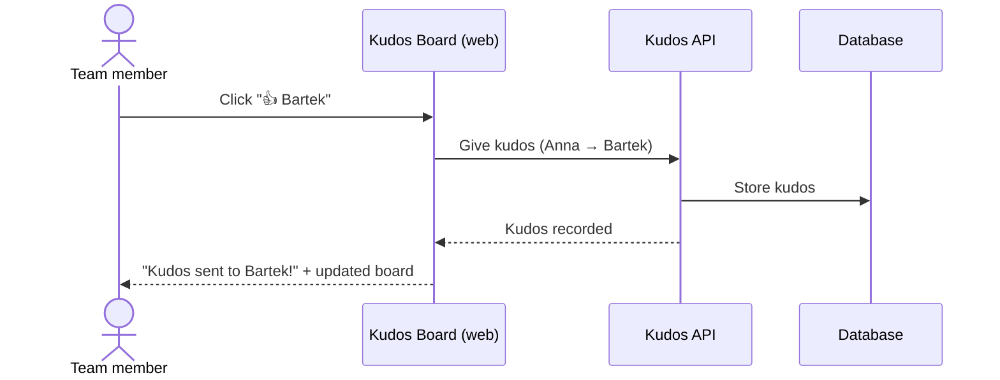
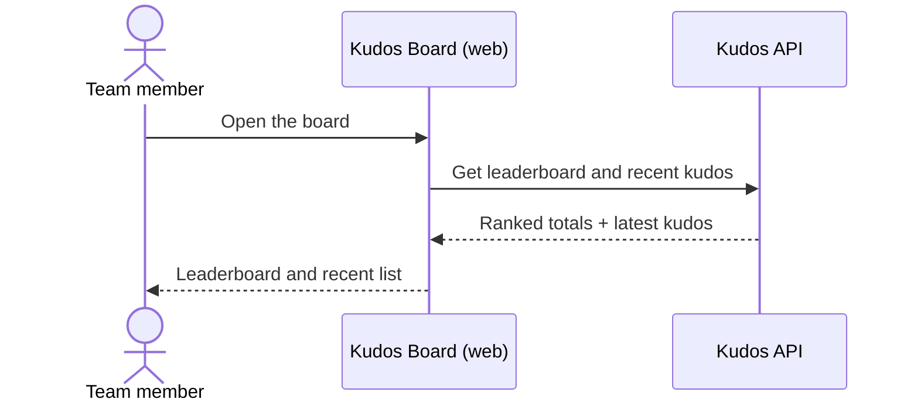

# Give Kudos

## Overview

Team members thank each other by giving kudos with one click. Every kudos is
stored, the leaderboard shows who received the most, and a recent list shows
the latest kudos so the team sees appreciation as it happens.

## Primary Actors

- **Team member** — gives kudos to teammates and reads the board.

## Business Rules

1. A team member can give kudos to any other team member.
2. A team member cannot give kudos to themselves.
3. The leaderboard ranks team members by kudos received, most first; ties are
   ordered alphabetically by name. Team members with no kudos are not listed.
4. The recent list shows the latest kudos, newest first.

## Error and Edge Cases

| Scenario | Expected behavior |
|----------|-------------------|
| Kudos to yourself | Rejected with a clear message; nothing is recorded |
| Unknown team member | Rejected; nothing is recorded |
| Giver or receiver missing | Rejected; nothing is recorded |

## User Stories

### US-KUDOS-1: Give kudos to a teammate

> As a **team member**, I want to give a teammate kudos with one click,
> so that good work is recognised straight away.



```gherkin
# Tests: api/test/give-kudos.acceptance.test.ts › AC-KUDOS-1
@AC-KUDOS-1
Scenario: Kudos given to a teammate is recorded
  Given Anna and Bartek are on the team
  When Anna gives kudos to Bartek
  Then the kudos is recorded
  And Bartek appears on the leaderboard with 1 kudos
  And the recent list shows "Anna → Bartek"

# Tests: api/test/give-kudos.acceptance.test.ts › AC-KUDOS-2
@AC-KUDOS-2
Scenario: Kudos to yourself is rejected
  Given Anna is on the team
  When Anna gives kudos to herself
  Then the kudos is not recorded
  And Anna is told she can't give kudos to herself

# Tests: api/test/give-kudos.acceptance.test.ts › AC-KUDOS-5
@AC-KUDOS-5
Scenario: Kudos to someone who isn't on the team is rejected
  Given Anna is on the team
  And nobody called Zofia is on the team
  When Anna gives kudos to Zofia
  Then the kudos is not recorded
  And Anna is told Zofia isn't a known team member

# Tests: api/test/give-kudos.acceptance.test.ts › AC-KUDOS-6
@AC-KUDOS-6
Scenario: Kudos that doesn't say who gives it or who gets it is rejected
  Given Anna is on the team
  When kudos arrives that names Anna as the giver but no receiver
  Then the kudos is not recorded
  And the sender is told both the giver and the receiver are required
```

### US-KUDOS-2: See who is appreciated

> As a **team member**, I want to see a leaderboard and the latest kudos,
> so that I know whose work the team values.



```gherkin
# Tests: api/test/give-kudos.acceptance.test.ts › AC-KUDOS-3
@AC-KUDOS-3
Scenario: The leaderboard ranks by kudos received
  Given Celina has received 2 kudos
  And Bartek and Darek have each received 1 kudos
  When anyone opens the board
  Then the leaderboard shows Celina first with 2
  And then Bartek and Darek with 1 each, in alphabetical order

# Tests: api/test/give-kudos.acceptance.test.ts › AC-KUDOS-4
@AC-KUDOS-4
Scenario: Recent kudos are shown newest first
  Given Anna gave kudos to Bartek
  And afterwards Celina gave kudos to Darek
  When anyone opens the board
  Then the recent list shows "Celina → Darek" above "Anna → Bartek"

# Tests: api/test/give-kudos.acceptance.test.ts › AC-KUDOS-7
@AC-KUDOS-7
Scenario: The board lists the whole team alphabetically
  Given Anna, Bartek, Celina and Darek are on the team
  When anyone opens the board
  Then they can pick from Anna, Bartek, Celina and Darek, in that order
```

## Scope

### In scope
- Giving kudos, the leaderboard and the recent list.

### Out of scope
- Limits on how many kudos someone can give (see `daily-kudos-limit`).
- Undoing kudos, weekly resets, sign-in.

### Not changing
- n/a (first feature)

## Verification

- Test output: `npm test` in `api/` — 7 acceptance tests, one per AC, against Postgres (Testcontainers).
  AC-KUDOS-5..7 were added later to pin down existing behaviour that mutation testing showed was untested.
- Traceability: `verify-ac-tests.sh` — every scenario has a test named after its AC ID
