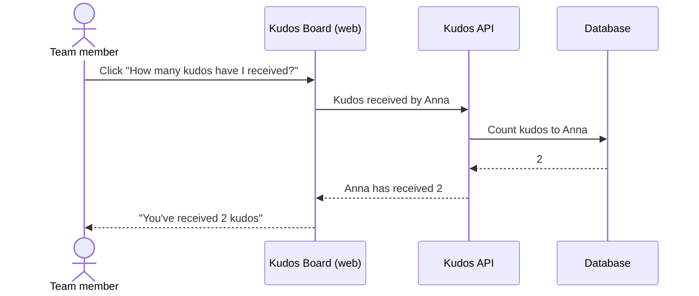

# Kudos Received

## Overview

A team member can check how many kudos they have received in total, with one
click, without scanning the leaderboard.

## Primary Actors

- **Team member** — wants to see their own total.

## Business Rules

1. The total counts every kudos the team member has ever received.
2. A team member who has received nothing sees 0.

## Error and Edge Cases

| Scenario | Expected behavior |
|----------|-------------------|
| Unknown team member | Rejected; nothing is shown |

## User Stories

### US-RECV-1: See my kudos total

> As a **team member**, I want to see how many kudos I have received,
> so that I know my work is noticed.



```gherkin
# Tests: api/test/kudos-received.acceptance.test.ts › AC-RECV-1
@AC-RECV-1
Scenario: A team member sees how many kudos they have received
  Given Bartek and Celina have each given Anna kudos
  When Anna checks how many kudos she has received
  Then she sees 2

# Tests: api/test/kudos-received.acceptance.test.ts › AC-RECV-2
@AC-RECV-2
Scenario: Someone who isn't on the team can't be looked up
  Given nobody called Zofia is on the team
  When someone checks how many kudos Zofia has received
  Then they are told Zofia isn't a known team member
```

## Scope

### In scope
- The total for the selected team member, shown on the board.

### Out of scope
- Breakdown by giver or by day.

### Not changing
- Leaderboard, recent list and the daily limit behave as before.

## Verification

- Test output:
