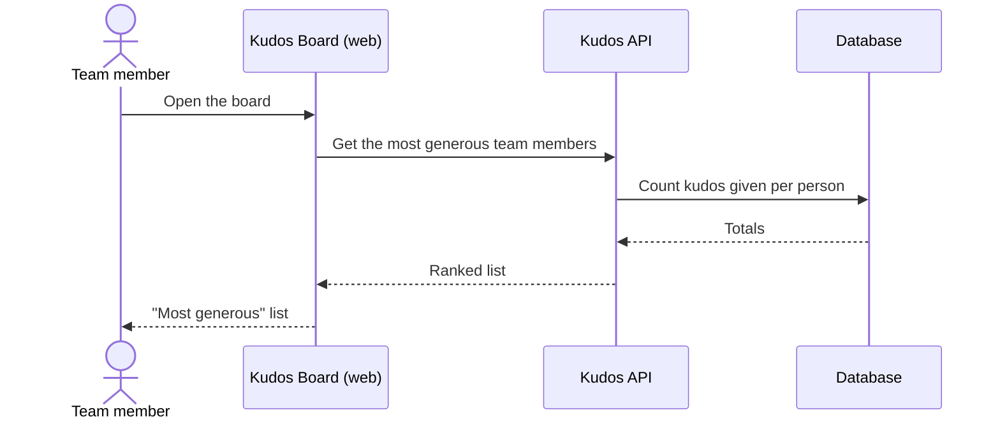

# Most Generous

## Overview

Alongside the leaderboard of who is appreciated, the board shows who
appreciates others most: team members ranked by how many kudos they have given.

## Primary Actors

- **Team member** — reads the board.

## Business Rules

1. Team members are ranked by kudos given, most first; ties are ordered
   alphabetically by name.
2. Team members who haven't given any kudos are not listed.

## Error and Edge Cases

| Scenario | Expected behavior |
|----------|-------------------|
| Nobody has given kudos yet | The list is empty |

## User Stories

### US-GIVERS-1: See who gives the most kudos

> As a **team member**, I want to see who gives the most kudos,
> so that generous teammates are recognised too.



```gherkin
# Tests: api/test/most-generous.acceptance.test.ts › AC-GIVERS-1
@AC-GIVERS-1
Scenario: Team members are ranked by kudos given
  Given Anna has given 2 kudos
  And Bartek and Celina have each given 1 kudos
  When anyone opens the board
  Then the most generous list shows Anna first with 2
  And then Bartek and Celina with 1 each, in alphabetical order

# Tests: api/test/most-generous.acceptance.test.ts › AC-GIVERS-2
@AC-GIVERS-2
Scenario: Nobody is listed before any kudos are given
  Given nobody has given kudos yet
  When anyone opens the board
  Then the most generous list is empty
```

## Scope

### In scope
- An all-time "Most generous" list on the board.

### Out of scope
- Weekly or daily variants.

### Not changing
- The existing leaderboard, recent list and daily limit.

## Verification

- Test output:
